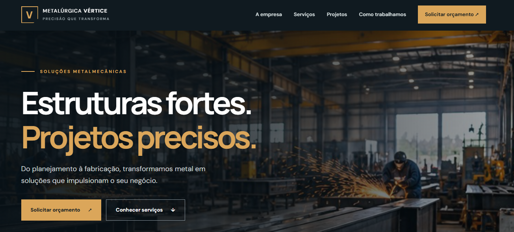
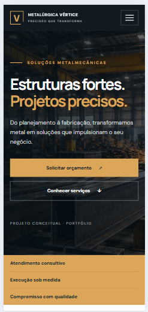
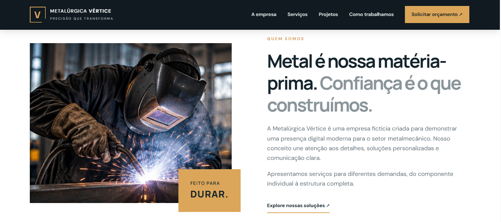
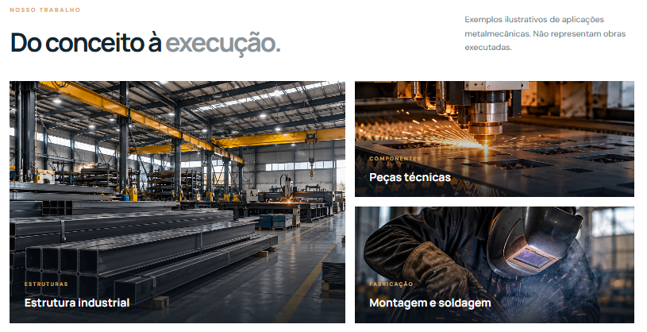

# Metalúrgica Vértice

Site institucional **fictício e demonstrativo** para uma empresa do setor metalmecânico, desenvolvido para portfólio com HTML, CSS e JavaScript.

## 🌐 Projeto online

Acesse o site publicado:

https://jefersonalvesrs.github.io/metalurgica-vertice/

## ✨ Funcionalidades

- Layout responsivo para computador, tablet e celular
- Menu mobile funcional
- Seções de apresentação, serviços, projetos ilustrativos e processo
- Formulário demonstrativo para preparar mensagem no WhatsApp
- Botão de voltar ao topo
- Imagens industriais ilustrativas locais em `assets/images`
- Sem backend e sem coleta de dados por servidor

## 🛠️ Tecnologias

- HTML5
- CSS3
- JavaScript (sem frameworks)

## 📁 Estrutura

```text
metalurgica-vertice/
├── index.html
├── style.css
├── script.js
├── assets/
│   └── images/
│       ├── hero.jpg
│       ├── sobre.jpg
│       ├── projeto-estrutura.png
│       ├── projeto-pecas.jpg
│       ├── projeto-solda.jpg
│       ├── favicon.svg
│       ├── screenshot-home.jpg
│       ├── screenshot-mobile.jpg
│       ├── screenshot-sobre.jpg
│       └── screenshot-projetos.jpg
└── README.md
```

## ▶️ Como executar

Abra `index.html` no navegador ou utilize a extensão Live Server no VS Code.

## 💬 WhatsApp

O formulário não envia mensagens enquanto `WHATSAPP_NUMBER` estiver vazio. Para ativar, configure um número autorizado em `script.js` no formato internacional, apenas com dígitos (exemplo fictício: `5554999999999`).

## 📸 Capturas de tela

### Página inicial


### Versão mobile


### Sobre a empresa


### Projetos


## ⚠️ Aviso

**Projeto conceitual.** A Metalúrgica Vértice, seus serviços e seus projetos são representações fictícias. As imagens industriais são ilustrativas e geradas por inteligência artificial; não documentam trabalhos realizados. Não há contato comercial real.